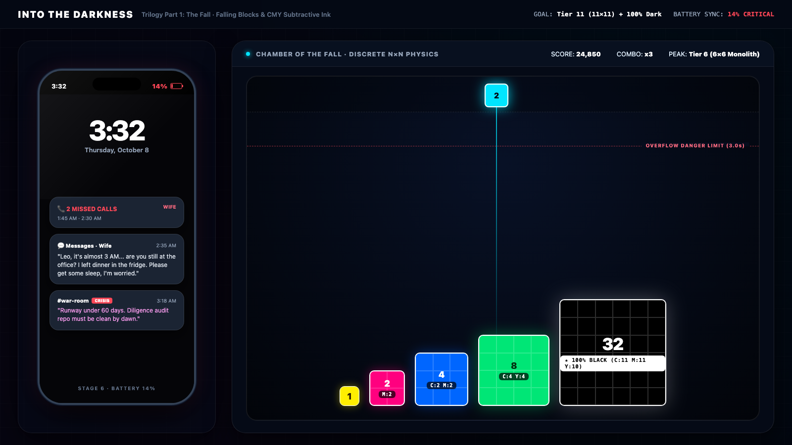

# Falling (Into The Darkness)

A 2D physics puzzle game and screenlife narrative built with JavaScript/HTML5 Canvas and Godot 4.

You drop square processor blocks with downward gravity into a chamber, merging matching tiers and combining subtractive CMY pigments toward pure black (`#000000`). Behind the translucent frosted-glass chamber, a dying smartphone screen receives incoming messages and alerts in real time, telling the story of an overnight system outage and personal collapse.



---

## Gameplay & Core Mechanics

* **Downward Gravity Physics:** Blocks drop from an overhead gantry with natural downward gravity ($g = 980\text{ px/s}^2$). Blocks collide, settle, and stack with AABB box physics and restitution damping.
* **Subtractive CMY Pigment Synthesis:** When two blocks of the same tier collide, they fuse into the next tier ($N + N \to N + 1$). Each merge accumulates Cyan ($C$), Magenta ($M$), and Yellow ($Y$) ink pigments, absorbing light until the inner die reaches pure black at Tier 11.
* **Dual-Layer Screenlife Narrative:** A phone screen sits beneath the chamber bed. As your score rises, real-time message notifications pop up over the board. You can tap them to sink them into your phone tray, or press **SWAP** (or `S`) to cross-fade focus directly to the phone screen (which pauses the physics simulation so you can read).
* **Buffer Overflow Limit:** An overvoltage hazard line sits near the top of the chamber. If settled blocks stack above this threshold continuously for 3.0 seconds, the hardware shuts down and triggers Game Over.
* **Procedural Web Audio:** Interactive sound synthesized live via the Web Audio API—smooth drop clicks, low-frequency resonant merge chimes that deepen with higher tiers, and layer-swap audio sweeps—with zero external audio file dependencies.

---

## 11-Tier Progression

Blocks scale strictly linearly by 1 unit ($14\text{px}$) per tier on a $24 \times 36$ chamber grid:

| Tier | Dimensions | Pixel Size | Chamber Width % | Package Spec | Inner Die Color |
|:---:|:---:|:---:|:---:|:---|:---|
| **1** | $1 \times 1$ | $14 \times 14\text{px}$ | 4.2% | SOT-23 Micro-Chip Mote | Primary Cyan / Magenta / Yellow |
| **2** | $2 \times 2$ | $28 \times 28\text{px}$ | 8.3% | QFN Dual-Pad Surface Mount | 2-unit blended pigment |
| **3** | $3 \times 3$ | $42 \times 42\text{px}$ | 12.5% | SOIC Leaded Frame | Early secondary mix |
| **4** | $4 \times 4$ | $56 \times 56\text{px}$ | 16.7% | BGA Dual-Core Processor | Solder-ball perimeter |
| **5** | $5 \times 5$ | $70 \times 70\text{px}$ | 20.8% | Quad-Core Ceramic IC | Centered square die |
| **6** | $6 \times 6$ | $84 \times 84\text{px}$ | 25.0% | Multi-Die Heterogeneous SoC | Dual-channel heat spreader |
| **7** | $7 \times 7$ | $98 \times 98\text{px}$ | 29.2% | Octa-Core Server CPU | Chamfered nickel lid |
| **8** | $8 \times 8$ | $112 \times 112\text{px}$ | 33.3% | Workstation Compute Carrier | Dense dark core |
| **9** | $9 \times 9$ | $126 \times 126\text{px}$ | 37.5% | MCM Neural Processing Die | Deep shadow substrate |
| **10** | $10 \times 10$ | $140 \times 140\text{px}$ | 41.7% | Multi-Socket Datacenter Module | Near-black core |
| **11** | $11 \times 11$ | $154 \times 154\text{px}$ | 45.8% | Titan Enterprise Monolith | **Pure Black (`#000000`)** |

---

## Playable Web Prototypes

The `web/` directory contains self-contained interactive prototypes and design tools:

| Experience | URL / Path | Description |
|:---|:---|:---|
| **Playable Game** | [`web/darkness.html`](web/darkness.html) | Primary playable game with downward gravity, CMY blending, live notifications, audio, and SWAP. |
| **Theme Showcase** | [`web/themes.html`](web/themes.html) | Interactive switcher comparing 5 visual skins (Sumi Ink, Amber Phosphor CRT, Nordic Brutalism, Cyber Obsidian, Optical Neon Gels). |
| **Narrative Storyboard** | [`web/storyboard.html`](web/storyboard.html) | Complete 11-stage screenlife narrative walkthrough and visual progression. |
| **Phone Screen Prototype** | [`web/phone_story_prototype.html`](web/phone_story_prototype.html) | Standalone interactive iPhone lockscreen simulation with incoming alerts. |
| **Chamber Grid Math** | [`web/presentation.html`](web/presentation.html) | Mathematical proofs and layout ratios for the $24 \times 36$ aspect-locked grid. |

---

## How to Run Locally

### 1. Web Version (Quickest)
Run the local lightweight Python server:
```bash
# Navigate to web directory and start the server
cd web
python3 server.py
```
Open **[http://localhost:8089/darkness.html](http://localhost:8089/darkness.html)** in your browser.

Or use Python's built-in module from the repository root:
```bash
python3 -m http.server 8080
# Open http://localhost:8080/web/darkness.html
```

### 2. Controls
* **Aim Dropper:** Drag the slider, or press `A` / `D` (or Left / Right Arrow).
* **Drop Block:** Click the board, or press `Space` / `W` (or Down Arrow).
* **Layer SWAP:** Press `S` or click the illuminated **SWAP** button at the bottom right to pause simulation and inspect the phone screen.
* **Melt Notification:** Click any incoming notification card to sink it into the background phone layer.

### 3. Godot Engine Version
Open [`project.godot`](project.godot) in **Godot 4.3+** or Summer Engine. The scene hierarchy and core scripts live in `scripts/game.gd` and `main.tscn`.

---

## Repository Structure

```
├── assets/                  # High-resolution UI textures, block frames, and themes
├── docs/                    # Design documentation, wireframe specs, and exports
│   ├── GDD.pdf              # Full Game Design Document (PDF export)
│   ├── wireframe_design_system.md  # 5-part Lunacy wireframe math specifications
│   └── archive/             # Archived early design notes and reference docs
├── scripts/                 # Godot GDScript engine files
├── tests/                   # Automated logic and physics test suites
├── web/                     # Interactive HTML5/JS simulation and prototypes
│   ├── darkness.html        # Main playable web game
│   ├── darkness.js          # Downward gravity physics, collision, and CMY engine
│   ├── darkness.css         # Responsive styling for mobile and desktop viewports
│   └── server.py            # Zero-dependency local development server
├── GDD.md                   # Canonical Game Design Document
├── LICENSE                  # MIT License
└── README.md                # Project overview and documentation
```

---

## Documentation

* **[Game Design Document (Markdown)](GDD.md)**: Full game mechanics, CMY pigment equations, narrative timeline, and audio synthesis design.
* **[Game Design Document (PDF)](docs/GDD.pdf)**: Complete printable document.
* **[Wireframe Design System](docs/wireframe_design_system.md)**: Mathematical specifications for the $24 \times 36$ chamber grid and multi-platform viewports.

---

## License

This project is open-source under the [MIT License](LICENSE).
